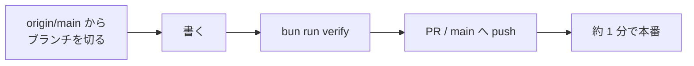

# 開発に参加する


ぴくたーちゃん「コードを書いてくれるの！？ありがとう〜！」

このページは、手を動かすときの流れと決まりごとをまとめたものです。
はじめての人は [README](README.md) の「3 分で動かす」から。

<br clear="right">

## 🌱 流れ



1. **`origin/main` から始める**。ブランチは `main` だけを残す運用です（古い作業は `archive/<ブランチ名>` タグ）。
2. 書く。ページ専用のものはそのルートの `components/` `hooks/` `utils/` `types/` に置く。
3. **push の前に `bun run verify`**（リント → テスト → 型チェック）。
4. PR を出すか、`main` に push する。**`main` への push はそのまま本番デプロイ**です。
5. 本番で確かめる（HTTP 200 ではなく、変えた箇所の中身で）。

## ✍️ 書き方

| 決まり | 理由 |
| --- | --- |
| `any` / `as any` / `@ts-ignore` で型エラーを隠さない | API の値は null のことが多い。型が守ってくれる |
| GraphQL は `graphql()`（gql.tada）で書き、結果の型を手書きしない | スキーマから自動で付く |
| `app/graphql-env.d.ts` は手で書かない | `bun run gql:generate` の生成物。CI が差分を見て落とす |
| リンクと遷移は `~/lib/app/locale-router` | `/en/...` の言語の接頭辞を保つ |
| 文言は `t("日本語", "English")` | 英語版も同時に作る |
| サーバー専用のコードは `*.server.ts` | ブラウザの JS に入らないように |
| `app/components/ui/` は基本的に触らない | shadcn/ui の生成物 |
| `($lang).app.*` と `($lang).flutter` から他の階層へ遷移しない | アプリの審査に影響する |
| ファイル名は小文字とハイフン | 既存に合わせる |

もっと細かい決まり（GraphQL のフラグメント、ルートの置き方など）は [AGENTS.md](AGENTS.md) にあります。

## 🧪 テスト

- `bun test`（happy-dom）。`*.test.ts(x)` を対象の隣か `__tests__/` に置く。
- 外の API に取りに行くテストは書かない（`fetch` は差し替える）。CI でもネットの状態に左右されないように。
- 詳しくは [docs/testing.md](docs/testing.md)。

## 📝 コミットメッセージ

日本語で、**何をして、なぜか** を 1 行目に書きます。読んだ人が画面を開かなくてもわかるくらい具体的に。

```text
作品ページの「XXさんの作品」: 最初は一覧で表示する（横スクロールに気づかれず、下まで見られていなかった）
```

## 🎨 大きな見た目の変更

メイン画面の配置を大きく変えるときは、前日にサイトのお知らせを出せるよう、先に運営に相談してください（突然の変更は問い合わせが多くなります）。

## 🆘 困ったら


- 型チェックが急に遅い・おかしい → `bun run check:full`（キャッシュを使わずに全部見る）
- ビルドが落ちる → `rm -rf build .vite && bun run build`
- `bun run dev` で古い画面が出る → `bun run dev:fresh`

<br clear="left">
