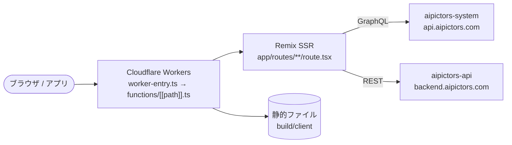

<div align="center">
  <a href="https://www.aipictors.com">
    
  </a>

  <h1>Aipictors Web</h1>

  

  <p><b>「ようこそ、Aipictors の開発へ！」</b> 〜 ぴくたーちゃんより</p>

  <p>
    <a href="https://github.com/aipictors/aipictors/actions/workflows/deploy.yml"></a>
    <a href="https://github.com/aipictors/aipictors/actions/workflows/test.yml"></a>
  </p>

  <p>
    <a href="https://remix.run/">Remix (Vite)</a> ·
    <a href="https://workers.cloudflare.com/">Cloudflare Workers</a> ·
    <a href="https://gql-tada.0no.co/">GraphQL (gql.tada)</a> ·
    <a href="https://ui.shadcn.com/">shadcn/ui</a> ·
    <a href="https://bun.sh/">bun</a>
  </p>
</div>

---

## 🚀 3 分で動かす

```bash
curl -fsSL https://bun.sh/install | bash   # bun 1.2 以上（Windows は winget install Oven-sh.Bun）
bun i                                       # 依存を入れる
bun run dev                                 # http://localhost:3000
```

> [!TIP]
> 隣に `../aipictors-system/.env` があれば、`bun run dev` が自動で読み込みます。なくても本番の GraphQL API（`https://api.aipictors.com/`）につながって動きます。

## 🧰 よく使うコマンド

| やりたいこと | コマンド | 時間の目安 |
| --- | --- | --- |
| 開発サーバー | `bun run dev` | — |
| 単体テスト | `bun test` | 約 10 秒 |
| 型チェック（差分だけ） | `bun run check` | 2 回目以降 数秒（初回 約 1.5 分） |
| 型チェック（全部やり直す） | `bun run check:full` | 約 1.5 分 |
| push 前の確認をまとめて | `bun run verify` | リント → テスト → 型チェック |
| 本番と同じビルド | `bun run build` | 約 40 秒 |
| GraphQL スキーマの更新 | `bun run gql:generate` | `schema.graphql` と `app/graphql-env.d.ts` を両方コミット |
| フォーマット | `bun run format` | Biome |

## 🗺️ 全体の地図



| 場所 | 中身 |
| --- | --- |
| `app/routes/` | ページ。`<名前>/route.tsx` だけがルートになる（`flatRoutes()`）。`($lang)` は省略できる言語の接頭辞 |
| `app/components/` | 共通コンポーネント。`ui/` は shadcn/ui の生成物 |
| `app/lib/` `app/utils/` `app/hooks/` | 共通のロジック |
| `app/graphql-env.d.ts` | `schema.graphql` から生成する型（手で書かない） |
| `functions/[[path]].ts` | 配信の入口（キャッシュ・クリティカル CSS など） |
| `worker-entry.ts` | Worker 本体（cron の IndexNow など） |
| `public/` | そのまま配信するファイル |
| `docs/` | 設計メモ・仕様（[一覧](docs/README.md)） |

## 🚢 デプロイ（main に push = 本番）


`main` に push すると、[`deploy.yml`](.github/workflows/deploy.yml) が **約 1 分** で本番（https://www.aipictors.com）に出します。

1. 依存を入れる（キャッシュなしで数秒）
2. **ビルド** と **リント + 単体テスト** を同時に走らせる（テストが落ちたら出さない）
3. `wrangler deploy`

型チェックは [`test.yml`](.github/workflows/test.yml) で並行して走ります（デプロイは待ちません）。tsc の途中結果をキャッシュしているので、ふだんは十数秒で終わります。ドキュメント（`*.md`・`docs/`）だけの変更ではデプロイしません。

> [!IMPORTANT]
> 型チェックはデプロイを止めません。push の前に `bun run verify`（または最低限 `bun run check`）を通してください。落ちていたら Actions の **Unit Tests & Code Quality** が赤くなります。

詳しくは [docs/deploy.md](docs/deploy.md)。

<br clear="right">

## 🤝 開発に参加する

- 開発の流れ・書き方: [CONTRIBUTING.md](CONTRIBUTING.md)
- AI エージェント向け: [AGENTS.md](AGENTS.md)（共通） / [CLAUDE.md](CLAUDE.md)（Claude Code）
- テスト: [docs/testing.md](docs/testing.md) · パフォーマンス: [docs/performance.md](docs/performance.md)

## 📣 不具合・ご意見


不具合は [Issue](https://github.com/aipictors/aipictors/issues/new/choose) から（GitHub アカウントが必要）。
ご意見・ご要望は [Discord](https://discord.gg/7jA2MmtvtR) で受け付けています。

<br clear="left">

---

<div align="center">
  
  <p><sub>Made with 💙🧡 by Aipictors — ぴくたーちゃんは <a href="https://www.aipictors.com/pictor-chan">こちら</a></sub></p>
</div>
