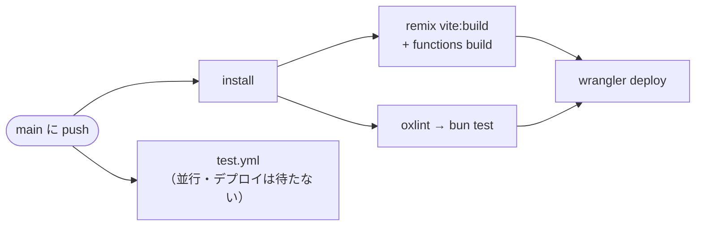

# デプロイと CI


`main` に push すると本番（https://www.aipictors.com）に出ます。手で何かをする必要はありません。

<br clear="right">

## ワークフロー

| ファイル | いつ | 何をする | 時間の目安 |
| --- | --- | --- | --- |
| [`deploy.yml`](../.github/workflows/deploy.yml) | `main` への push（ドキュメントだけの変更を除く）・手動 | ビルド ∥ (リント → テスト) → `wrangler deploy` | 約 1 分 |
| [`test.yml`](../.github/workflows/test.yml) | PR・`main` への push | リント・テスト ∥ GraphQL 型の生成チェック → 型チェック。Dependabot の patch 更新は通ったら自動マージ | 十数秒〜1 分 |
| [`gh-release.yml`](../.github/workflows/gh-release.yml) | 毎日 0:00（日本時間） | その日のリリースノート | — |



## 速くするためにしていること

以前は push から本番まで約 4 分かかっていました（テスト・型チェックが終わるのを待ってからビルドしていたため）。

| 以前 | いま | 効果 |
| --- | --- | --- |
| デプロイが test.yml（型チェック 約 90 秒）の完了を待つ | 型チェックは並行。デプロイを止めるのはリントと単体テストだけで、それもビルドと同時に走る | 約 2 分短縮 |
| 毎回 tsc で全ファイルを型チェック | `tsc --incremental` の途中結果（`node_modules/.cache/tsc.tsbuildinfo`）を Actions のキャッシュで引き継ぐ | 約 90 秒 → 数秒〜十数秒 |
| 同じテストが 3 本のワークフローから 3 回走る | test.yml の 1 回だけ | Actions の枠を空ける |
| bun のキャッシュを復元（約 10 秒） | そのまま `bun install`（約 4 秒） | 約 6 秒短縮 |
| ビルドで gzip 後のサイズを計算 | `build.reportCompressedSize: false` | 約 6 秒短縮 |
| ドキュメントの変更でもデプロイ | `*.md`・`docs/**` だけの変更ではデプロイしない | — |
| 続けて push すると全部デプロイ | 新しい push が来たら古いデプロイは止める（`concurrency`） | — |

## 注意

- **型チェックはデプロイを止めません**。型は実行時の JS に影響しませんが、壊れた型を main に残さないよう、push の前に `bun run check` を通してください。
- ビルドの環境変数はリポジトリの `.env` と、Actions のシークレット `VITE_MICRO_CMS_API_KEY`。Worker が実行時に使う変数は `wrangler.toml` と Cloudflare のダッシュボード。
- デプロイに使うシークレット: `CLOUDFLARE_ACCOUNT_ID`・`CLOUDFLARE_API_TOKEN`。
- デプロイできたかは HTTP 200 ではなく、変えた箇所の HTML やデータで確かめる。

## 戻すとき

Cloudflare のダッシュボード（Workers → aipictors → Deployments）で前のバージョンに戻すか、手元で:

```bash
bun x wrangler deployments list --name=aipictors
bun x wrangler rollback --name=aipictors <version-id>
```

その後、原因のコミットを `git revert` して `main` に push します。
